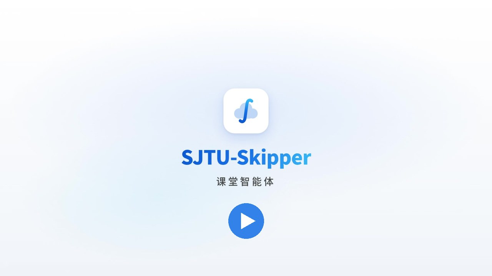
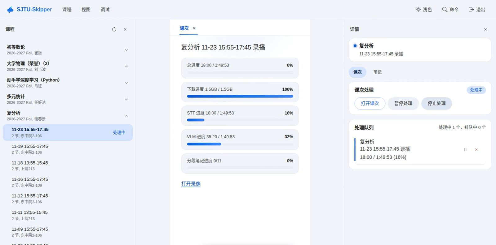
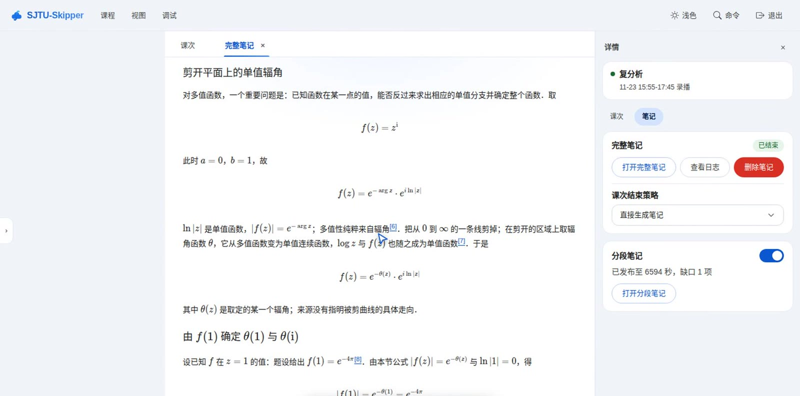
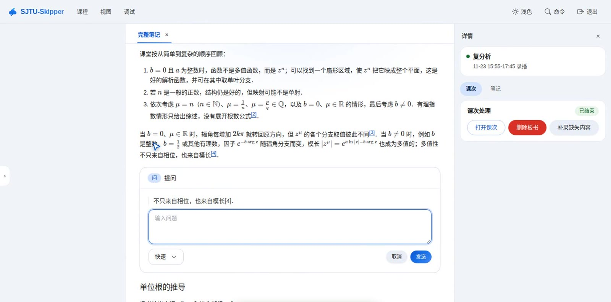
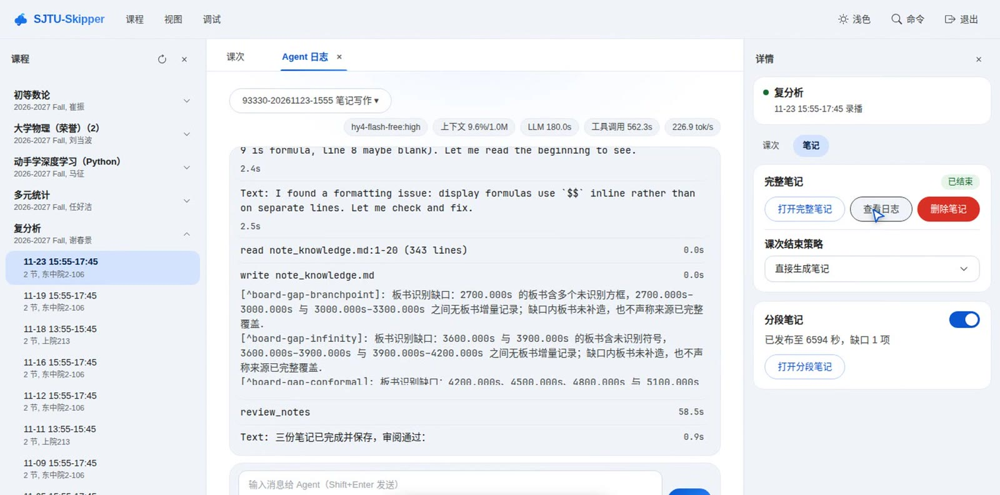
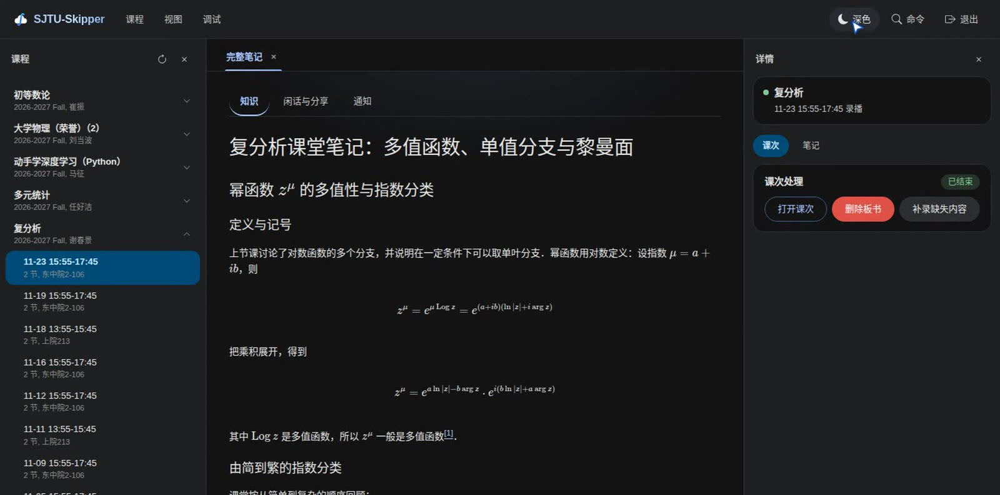
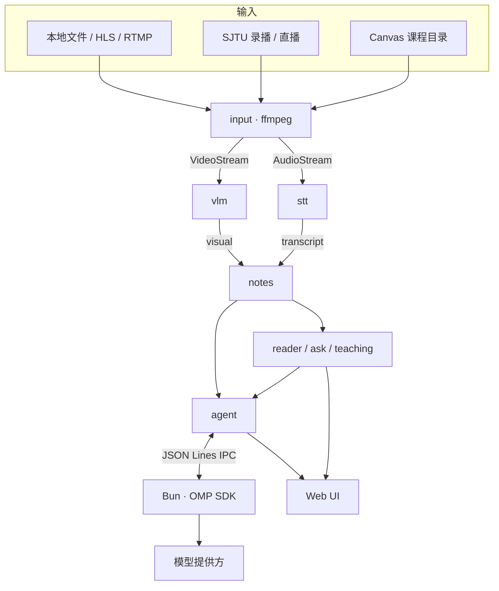

<div align="center">


<h1>SJTU-Skipper</h1>

<p><strong>两小时的课，只需十八分钟．</strong></p>

<p>接入上海交大 Canvas 与视频门户，自动完成语音转写、板书识别、<br />结构化笔记、划词问答与互动式教学．</p>

<p>
  <a href="https://www.python.org/"></a>
  <a href="https://bun.sh/"></a>
  <a href="https://fastapi.tiangolo.com/"></a>
  <a href="#许可"></a>
</p>

</div>

[](docs/assets/SJTU-Skipper_promo.mp4)

<div align="center">
  <a href="docs/assets/SJTU-Skipper_promo.mp4">▶ 观看 1 分 53 秒演示视频</a>
</div>

> 从 Canvas 选课，到一份可读、可问、可复习的笔记，全部在一个本地 Web 界面里完成．

## 怎么做到的

核心方法可以概括为两个：把长课堂拆成流，把复杂任务拆成角色．

### 01　把课堂拆成可并行的流

一堂课不是一个大文件，而是四条同时前进的流：

```text
音频 ──► STT ──► 转写 ─┐
                       ├──► 分段笔记 ──► 完整笔记 ──► 审阅 ──► 发布
视频 ──► VLM ──► 板书 ─┘
```

- 音频、视频、转写和板书都是 append-only 流，输入只负责追加，识别消费者各自维护读取位置．
- 下载、解码、转写、板书识别重叠进行；直播和录播共用同一条管线．
- 处理位置与覆盖区间单独记录，断线可重传，失败范围会留下缺口而不是悄悄跳过．

**解决的问题**：两小时的课不必等下载和转写全部结束才开始；多节连堂、直播和中断恢复都能按同一套逻辑处理．

### 02　把写作、审阅和教学拆给不同角色

让一个模型从头写到尾，长上下文会漏、自己审自己会护短、教学时容易直接说出答案．项目把这些职责拆开：

- **笔记**：按 10 分钟分段并行写底稿 → 合并成完整笔记 → 由只读的笔记审阅角色核对来源覆盖与正确性 → 通过后才能发布．
- **教学**：教案模型只生成教案；判卷模型只判断学生答得怎么样；控制器按固定决策表决定下一步；授课模型只执行当前动作，看不到本步答案和后续步骤．
- **偏好**：Agent 只能提议修改学习偏好，必须由用户在设置页确认，避免模型擅自改画像．

**解决的问题**：长课次写得全、审阅不被写作角色带偏、互动教学不提前泄题．

## 实现了什么

| 能力 | 说明 |
| --- | --- |
| **课程接入** | 从 Canvas 课程目录选择课次，直接处理 SJTU 录播与直播；也支持本地文件、HLS/RTMP/HTTP URL．多节录播接成连续时间轴，本节处理时预取下一节． |
| **语音转写** | 兼容 HTTP/WebSocket 服务支持录播离线与直播流式识别，直播显示临时文字、只把定稿写入记录；Google Cloud STT v2 走批量窗口．断线重传，失败范围保留为缺口． |
| **板书识别** | 按窗口采样视频帧，融合多帧后交给视觉模型逐板面转录，按历史窗口去重，并记录每段板书的来源覆盖． |
| **结构化笔记** | 分段笔记并行生成，汇总成完整笔记，再由笔记审阅角色核对来源与正确性；保留 3 份底稿、发布锁与可恢复的修订会话． |
| **划词问答** | 在笔记中选中任意文字提问，快速问答直接回答，研究问答可读取授权材料；答案以 `qa` 块写回笔记，可折叠、删除、随笔记发布． |
| **互动式教学** | 先生成结构化教案，再按「判卷 → 决策 → 授课」分离的流程逐步引导；支持分级提示、常见误解、复述检查与前置方法诊断． |
| **学情与偏好** | 用五级掌握度记录知识点，跨课次保留；教学偏好只能由 Agent 提议、用户确认后写入． |
| **模型与计费** | 多提供方接入、按角色分配模型、OpenCode Go 设备授权；按课次与任务部分累计 token 与费用． |
| **Agent 工作台** | 多会话并行、流式事件、原生 `read`/`grep`/`glob`/`edit`/`write`、消息中断后继续、按会话授权的文件工作区． |

### 界面

| 课次处理 | 完整笔记 |
| :---: | :---: |
| [](docs/assets/screenshot-progress.jpg) | [](docs/assets/screenshot-notes.jpg) |
| 下载、转写、板书与分段笔记并行推进． | 公式、脚注与来源编号完整保留． |

| 划词问答 | Agent 日志 |
| :---: | :---: |
| [](docs/assets/screenshot-ask.jpg) | [](docs/assets/screenshot-agent.jpg) |
| 选中文字即可提问，答案写回笔记． | 写作、审阅与工具调用全程可见． |

深色主题同样是完整的一套：

[](docs/assets/screenshot-dark.jpg)

## 部署

### 依赖

| 依赖 | 要求 |
| --- | --- |
| Python | ≥ 3.13 |
| Bun | ≥ 1.4.4 |
| uv | 最新版 |
| ffmpeg / ffprobe | 解码与转码 |
| Nix | 可选，仓库自带 devShell（当前声明 `x86_64-linux`） |

```bash
git clone https://github.com/itheamyvalgulious/SJTU-Skipper.git
cd SJTU-Skipper

# 可选：进入 Nix devShell，获得 Python / Bun / uv / ffmpeg
nix develop

uv sync --locked --extra dev
bun install --frozen-lockfile
```

不使用 Nix 时，自行安装上表依赖，再执行同样的 `uv sync` 与 `bun install`．

### 启动

```bash
./start.sh check   # 只检查插件拓扑，打印加载顺序与服务，然后退出
./start.sh         # 启动 Web UI，默认 http://127.0.0.1:8765
./start.sh --port 9000
```

> `start.sh` 需要前台运行才能接收 Ctrl+C．不要在命令后加 `&`、`nohup` 或 `setsid`．首次 Ctrl+C 会在 5 秒内优雅退出，再按一次可强制退出．

端口被占用时用 `./start.sh --port 9000`；需要局域网访问时加 `--host 0.0.0.0`，并自行确保认证与 TLS．

可选配置文件：

```bash
cp .env.example .env                 # STT 地址、Google 凭据等环境变量
cp agent.toml.example agent.toml     # 数据目录、监听地址、插件开关
```

## 第一次使用

1. **登录**．首次启动会生成 `data/agent/auth.json`，用户名为 `admin`，随机密码只打印在启动日志中．修改密码后重启服务；忘记密码可编辑该文件的 `users` 字段，删除文件会同时清掉保存的模型凭据．
2. **配置 Canvas**．在 Canvas 的「账户 → 设置」新建访问令牌，再填入「设置 → Canvas」；Canvas 地址默认 `https://oc.sjtu.edu.cn`．
3. **配置 STT**．选择「兼容服务」并填写地址（默认 `http://127.0.0.1:8766`）与语言，或选择 Google Cloud Speech-to-Text v2 并填写凭据、项目与模型．兼容 STT 服务需要自行部署，项目不自带识别服务．
4. **配置 LLM**．在「设置 → LLM」添加提供方（OpenAI 兼容端点、OpenCode Go 或手动配置）、填写 API Key 或完成设备授权、检查端点模型，再把模型分配给各个角色．
5. **开始上课**．刷新课程列表，展开课程，选择课次，点击「开始处理」．

## 日常使用

1. **处理课次**：任务进入队列，直播优先．媒体输入按课次排队，语音、板书和笔记任务可以同时执行．课次页显示总进度、下载、STT、VLM 与分段笔记进度，错误集中显示在进度下方．
2. **阅读笔记**：完成后打开「完整笔记」．左侧课程树切换课次，右侧面板处理笔记与教学；面板可收起、拖动或双击分隔条调整宽度，窄屏下用抽屉．
3. **划词提问**：在笔记中选中文字，选择「快速」或「研究」．答案写回当前笔记，刷新或重启后仍在．
4. **继续修订**：已发布的笔记可以在写作日志中继续发消息．消息会中断当前模型回合或工具等待，再在同一任务中继续；笔记审阅独立进行，旧输入的审阅结果不能批准修改后的内容．
5. **互动式教学**：在课次右侧打开「教学」，生成教案后开始对话．提示按钮逐级给提示，学生说「直接讲」时只讲当前这一步，单元结束会要求复述．

输入消息时 `Enter` 换行，`Shift+Enter` 或 `Ctrl+Enter` 发送；`Esc` 关闭抽屉．

## 开发

```bash
.venv/bin/python -m pytest -q   # Python 测试
bun run check                   # TypeScript 类型检查 + Biome lint
nix fmt                         # 可选：ruff / biome / nixfmt / shfmt / taplo
```

确定性测试使用脚本化运行时与本地请求记录，覆盖配置、IPC、授权和应用行为；真实模型验收单独执行并保存请求与文稿记录．

## 架构



为简洁，图中省略 `settings`、`llm` 等基础插件；所有模型调用最终都经过 `llm` 插件管理的 OMP SDK 运行时，`agent` 负责其中的会话与工具执行．

- **Python 负责编排**：输入、识别、笔记、教学、持久化和 Web 服务都在 Python 侧；模型会话交给一个常驻 Bun 子进程，通过 JSON Lines IPC 调用 OMP SDK．
- **插件是 DAG**：插件用 `id` 与 `requires` 声明依赖，按拓扑序加载，只通过 `ctx.services` 互相调用．UI 由声明式 block 与 action 组成，插件不写前端代码．
- **数据留在本地**：运行产物在 `data/agent/`，媒体流在内存中流转，转写、板书、笔记与费用落盘，本地录像可选保留．登录密码使用 scrypt 哈希；只有你配置的识别与模型提供方会收到相应的音频、图像或文本．
- **取消是真实的**：中断消息会终止对应的模型流和工具执行，而不只是关闭界面上的输出．

更细的设计见 [`docs/architecture.md`](docs/architecture.md)，插件接口见 [`docs/plugin-api.md`](docs/plugin-api.md)，统一术语见 [`docs/terminology.md`](docs/terminology.md)．

## 许可

MIT，见 [`pyproject.toml`](pyproject.toml)．

本项目不是上海交通大学官方产品．演示视频与截图中的课程内容仅用于展示，版权归原课程作者所有．

<div align="center">
  <sub>Built for SJTU classrooms · 把课堂还给自己</sub>
</div>